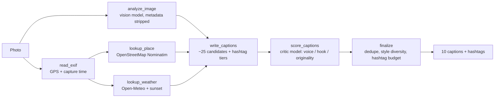

# SnapCaption

Drop in a photo, get **10 ranked captions plus hashtags** that fit the place, the light and your own voice. No copy-pasting between AI chat apps.

Two ways to use it, one engine:

- **Web app (Streamlit):** open the link, drop a photo, captions appear on their own. One tap copies caption + hashtags.
- **Share-sheet shortcut (iPhone Shortcuts / Android HTTP Shortcuts):** Photos → Share → "Caption this" → pick one → it's on your clipboard. Nothing to open.

## How it works



A [LangGraph](https://langchain-ai.github.io/langgraph/) pipeline. Image analysis, place lookup and weather lookup run **in parallel**; writing waits for all three.

| Design choice | Why |
|---|---|
| Model only *scores*; ranking, de-duplication, style caps and hashtag budgets are plain code | Testable and explainable; the critic can fail without breaking the app |
| Every enrichment step degrades gracefully | No GPS, geocoder down or weather down still yields captions, plus a note |
| Never claims what it doesn't know | No timestamp means no "golden hour"; no sunset data means no golden-hour claim |
| Model never sees coordinates or EXIF | Photo is resized and re-encoded without metadata; location reaches the model only as a place name |
| Voice samples (your past captions) go in as few-shot examples | Output sounds like you, not generic AI |
| Feedback log (what you picked, how it did) | "Would it do well?" can't be predicted, but it can be measured |

## Quick start (local)

Needs Python 3.11+ and a free Gemini key from <https://aistudio.google.com/apikey>.

```bash
cd snapcaption-agent
python -m venv .venv && source .venv/bin/activate      # Windows: .venv\Scripts\activate
pip install -r requirements-dev.txt
cp .env.example .env                                    # then paste your GEMINI_API_KEY
pytest -q                                               # 100+ tests, no network or key needed
streamlit run app_streamlit.py                          # web app on http://localhost:8501
uvicorn api:app --reload                                # API on http://localhost:8000 (separate terminal)
```

Try it from your phone on the same Wi-Fi: `streamlit run app_streamlit.py --server.address 0.0.0.0`, then open `http://<your-computer-ip>:8501`.

API smoke test:

```bash
curl -H "X-API-Key: $API_KEY" -F file=@photo.jpg -F user_id=me "http://localhost:8000/caption?format=text"
```

### First-run checklist (do this once with a real key)

The test suite mocks the model, geocoder and weather services, so confirm the live calls once:

1. Upload a photo that has location (taken with Location Services on). You should see a 📍 place chip, a weather chip and a time chip above the captions.
2. If you see "model had a problem … 404 / NOT_FOUND": the Gemini model code changed. Set `GEMINI_MODEL` in `.env` to a current code from Google's model docs.
3. If you see "geocoder unavailable": set `NOMINATIM_USER_AGENT` to something that identifies you (their policy requires it) and check your network.
4. No place chip but no warning? The photo has no GPS (see *iPhone location* below). Type the place in the box instead.

## Deploy

**Web app → Streamlit Community Cloud (free)**

1. Push this folder to a GitHub repo (`.env` is git-ignored; never commit keys).
2. <https://share.streamlit.io> → *Create app* → pick the repo, main file `app_streamlit.py`.
3. *Advanced settings → Secrets*, paste:
   ```toml
   GEMINI_API_KEY = "your-key"
   NOMINATIM_USER_AGENT = "snapcaption/0.1 (you@example.com)"
   ```
4. Deploy. Bookmark `https://<your-app>.streamlit.app/?u=yourhandle` on your phone's home screen.

Note: the app's disk is wiped on restart/redeploy, so saved voice samples and stats can reset. Fine for a demo; for real use put `DB_PATH` on a persistent volume (see below) or swap SQLite for a hosted database.

**API → any free Docker host (for the share-sheet shortcut)**

The `Dockerfile` serves the FastAPI app on `$PORT`. It installs only `requirements-api.txt` (no Streamlit), which keeps the image around 460 MB, and runs as a non-root user.

- *Render:* New → Web Service → connect the repo → runtime Docker. Environment: `GEMINI_API_KEY`, `API_KEY` (a long random string), `NOMINATIM_USER_AGENT`. Free instances sleep when idle, so the first request after a while is slow.
- *Oracle Cloud Always Free VM (stays on, keeps your data):*
  ```bash
  docker build -t snapcaption .
  docker run -d --restart unless-stopped -p 8080:7860 -v snapcaption-data:/data --env-file .env snapcaption
  ```
  Put HTTPS in front (Caddy or a Cloudflare Tunnel) before sending your API key from a phone.
- *Hugging Face Spaces (Docker):* works too; add the `sdk: docker` / `app_port: 7860` header to a Space README.

Always set `API_KEY` on a public API. Without it, anyone who finds the URL can spend your model quota.

## The share-sheet shortcut (the "no app to open" part)

**iPhone (Shortcuts app)**

1. Shortcuts → **+** → name it *Caption this*. Tap the **(i)** button → enable **Show in Share Sheet** → set accepted types to **Images** only.
2. Add action **Get Contents of URL**
   - URL: `https://YOUR-API-HOST/caption`
   - Expand *Show More*: Method **POST**
   - Headers: `X-API-Key` = your key
   - Request Body: **Form**, then add fields:
     - `file` → type **File** → value **Shortcut Input**
     - `user_id` → type **Text** → your handle
     - optional `platform` → Text → `instagram` (or `tiktok`, `threads`, `x`, `linkedin`)
3. Add **Get Dictionary Value** → key `choices` → from *Contents of URL*.
4. Add **Choose from List** (input: the dictionary value). Each option is a caption with its hashtags, ready to paste.
5. Add **Copy to Clipboard**.
6. Optional, logs your pick for the stats: add another **Get Contents of URL** → POST to `/pick`, header `X-API-Key`, body **JSON** with `generation_id` (Get Dictionary Value `generation_id` from step 2's response) and `text` (the *Chosen Item*).

Use it: Photos → select a photo → Share → *Caption this* → tap a caption → paste into Instagram.

**Android:** the free open-source *HTTP Shortcuts* app does the same: create a shortcut that POSTs the shared file as multipart field `file` with the `X-API-Key` header, and enable it as a share target.

**iPhone location:** the share sheet and some pickers can strip location. If captions come back without a place, tap **Options** at the top of the share sheet and make sure **Location** is on. If a source still drops it, pass a `place` form field (or type it in the web app).

## Measuring "would this do well?"

Nobody can predict virality, and hashtag volume isn't available from Instagram's public API. So the app measures instead:

- **Top-3 pick rate:** share of the captions you use that were ranked 1-3. If you picked at random from 10, you'd land in the top 3 only **30%** of the time, so a higher number means the ranking matches your taste.
- **Style win-rate:** which styles you actually pick (witty, minimal, storytelling...).
- **Likes/reach by style:** log results on the *Results* tab (or `POST /outcome`) a day after posting.

Treat per-style likes as a hint, not a verdict: with a few dozen posts, audience, time and photo quality swamp everything else, and a hashtag's effect can't be isolated. Tune from the data in `snapcaption/platforms.py` (caption length, hashtag count per platform) and `snapcaption/prompts.py` (style mix).

## Privacy

- The photo sent to the model is resized and re-encoded with **no metadata**. The model never receives GPS, timestamps or camera info.
- Place names come from reverse geocoding at about 10 m precision; only venue/neighbourhood, city and region are kept (no street or house number). When the nearest match is a small shop or a street, the same rounded point is checked against OpenStreetMap's free Overpass API for an enclosing park or landmark. Weather lookups use about 1 km precision.
- Stored in SQLite: caption text, a coarse place label, your picks and results. **No photos, no coordinates.**
- Photos are sent to your model provider. Check the current terms for your plan: on free API tiers, providers may use submitted content to improve their products. Use a paid key (or the Anthropic provider) if you or your users upload private photos.
- Nominatim's public server is for light use (one request per second, identifying User-Agent). For a real launch, use a paid geocoder or host your own.

## Configuration

All via environment variables (see `.env.example`): `LLM_PROVIDER` (`gemini` | `anthropic`), `GEMINI_API_KEY`, `GEMINI_MODEL`, `ANTHROPIC_API_KEY`, `ANTHROPIC_MODEL`, `API_KEY`, `DB_PATH`, `NOMINATIM_USER_AGENT`, `TEMP_UNIT`, `MAX_UPLOAD_MB`.

Swap providers by changing `LLM_PROVIDER`; `snapcaption/llm.py` is the only file that talks to a model SDK.

## Project layout

```
app_streamlit.py          web UI (captions / my voice / results tabs)
api.py                    FastAPI: /caption /pick /outcome /voice /metrics /health
snapcaption/
  pipeline.py             LangGraph: parallel enrichment, generate, critic, rank
  service.py              the one function both front ends call
  llm.py                  Gemini + Anthropic wrappers, JSON parsing, retries
  prompts.py              all prompt text
  ranking.py              scoring weights, penalties, de-dupe, diversity
  hashtags.py             sanitising, location tags, per-platform budgets
  store.py                SQLite: voice samples, batches, picks, outcomes
  tools/                  exif.py, geo.py (Nominatim), weather.py (Open-Meteo), timectx.py
tests/                    fake model + fake services; 100+ tests
Dockerfile                API container
```

## Resume bullets (fill in your real numbers)

- Built **SnapCaption**, a multimodal LangGraph agent that turns one photo into 10 ranked, voice-matched captions and tiered hashtags: EXIF → reverse-geocoding, weather and golden-hour context, parallel tool branches, generator + critic ranking with deterministic diversity rules.
- Shipped as a Streamlit app and a FastAPI endpoint driven from the iOS share sheet; privacy by design (metadata stripped before model calls, no photos or coordinates stored).
- Instrumented a feedback loop (top-3 pick rate, style win-rate, likes by style). Across **[N]** posts, **[X%]** of used captions came from the top 3 ranked vs a 30% random baseline. *(Use your real numbers from the Results tab.)*
- 100+ automated tests with a fake LLM and mocked services; graceful degradation when GPS, geocoder, weather or the critic model fail.

## Known limits

- Live calls to Gemini, Nominatim and Open-Meteo are exercised only through mocks in the test suite; run the first-run checklist above.
- Free hosts sleep or reset disks; the Gemini free tier has rate limits. The API has a key but no rate limiting.
- Captions are suggestions. Read them before posting.
